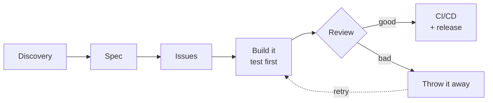

## Hi, I'm Natan

Software engineer working across backend, data and AI. I build Java/Spring and Python services and Angular frontends, and use data to decide, not guess. Currently doing an MBA in AI & Big Data at ICMC-USP.

Where I'm heading: systems where code, data and container monitoring meet every day.

  

### How I ship

Programming has changed a lot, and code is cheap to write now. I don't get attached to it: when an agent's attempt is bad, I throw it away and run it again. Small commits make that safe and keep reviews short.

### Selected work

| Project | What it is |
|---|---|
| [aws-kafka-async-payments](https://github.com/natansalvadorligabo/aws-kafka-async-payments) | Async PIX-inspired payment intake. While the consumer is down, payments wait on the queue; a duplicate delivery settles once; a poison message ends up in the DLQ. Spring and Lambda consumers share one settlement core, tested against LocalStack. |
| [agents-at-work](https://github.com/natansalvadorligabo/agents-at-work) · [claude-usage-meter](https://github.com/natansalvadorligabo/claude-usage-meter) | Claude Code mods for seeing what coding agents do and what they cost: a voxel office that shows tool calls and subagents live, and a footer meter for context, session and weekly usage. |
| [ensemble-verdict-churn](https://github.com/natansalvadorligabo/ensemble-verdict-churn) | Churn prediction with five local classifiers. When the vote splits 3–2, a local Qwen model arbitrates. |

### Community

- **[Oficina das Meninas](https://github.com/Oficina-das-Meninas)**: a nonprofit for girls aged 6 to 17. It started as a university extension project. 100+ commits to its public website, 30+ pull request reviews and 30+ issues.

### Stack

**Backend:** Java, Spring Boot, Python, Go, Node.js 
**Frontend:** Angular, React, TypeScript 
**Data:** SQL, Oracle, PL/SQL, PostgreSQL, MongoDB, DynamoDB, Spark 
**Cloud & ops:** AWS, Google Cloud, Docker, GitHub Actions, GitLab CI 
**AI:** LLMs, RAG, agents, MCP, n8n 
**Agent harnesses:** Claude Code, Codex, OpenCode

### Contact

[LinkedIn](https://www.linkedin.com/in/natansalvadorligabo/)
